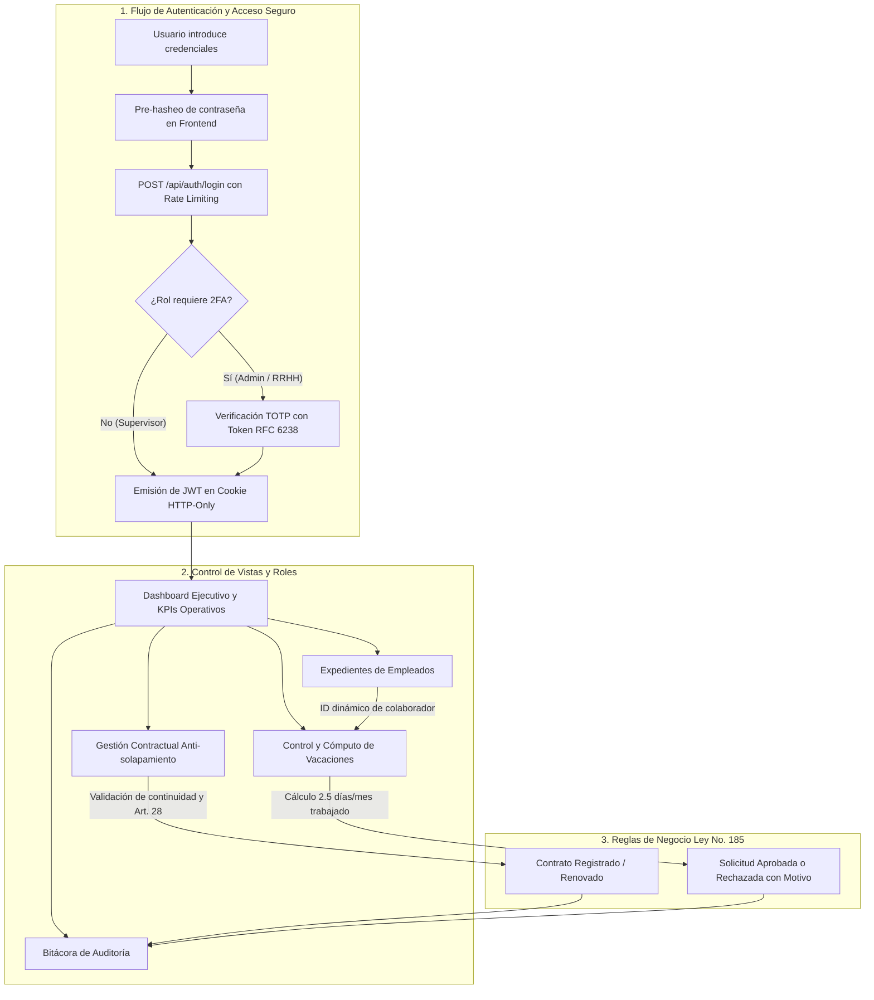

# Estado Integral del Proyecto — Sistema de Gestión de Recursos Humanos
**Taller de Torno Morales López (Managua, Nicaragua)**

---

## 📌 1. Estado Actual del Repositorio y Entorno

- **Directorio Raíz:** `C:\Users\davis\.gemini\antigravity\scratch\torno-morales-rrhh`
- **Rama Principal:** `main` (alineada y actualizada con `origin/main`).
- **Estado de Git:** Limpio (*working tree clean*, sin cambios pendientes).
- **Validación de Compilación:**
  - **Frontend (Next.js 16 + React 19 + TypeScript):** Compilación de producción con Turbopack exitosa (10 rutas estáticas y dinámicas verificadas con 0 errores de compilación y 0 advertencias de tipos).
  - **Backend (.NET 9 + C#):** Arquitectura Hexagonal compilada sin advertencias, 41 pruebas unitarias (26 de Dominio y 15 de Aplicación) aprobadas y migraciones de EF Core listas para PostgreSQL 16.
  - **Contenedores:** Archivos `Dockerfile` (multi-stage para backend y standalone para frontend) y `docker-compose.yml` listos para orquestar la infraestructura con un único comando.

---

## 🔄 2. Flujo del Sistema

El sistema implementa un ciclo de vida completo para la administración del capital humano de un taller industrial, asegurando cumplimiento legal y seguridad por diseño:



### Recorrido Paso a Paso:
1. **Autenticación Blindada:**
   - La contraseña es transformada en el cliente antes de transmitirse por la red como defensa en profundidad.
   - El endpoint `/api/auth/login` está protegido por un **Rate Limiter nativo de .NET 9** (ventana deslizante de 5 intentos cada 15 minutos).
   - Los roles con privilegios elevados (`Administrador` y `RRHH`) deben superar obligatoriamente la verificación de doble factor (**2FA TOTP**) compatible con Google Authenticator o Microsoft Authenticator.
   - La sesión se mantiene mediante un token JWT almacenado en **Cookie `HttpOnly`, `Secure` y `SameSite=Strict`**, impidiendo el robo por scripts maliciosos (XSS).

2. **Dashboard Ejecutivo y Búsqueda Global:**
   - El Top Navbar contiene un buscador reactivo integrado y una interfaz limpia con acceso ergonómico a cerrar sesión junto al perfil.
   - El Dashboard muestra indicadores en tiempo real y gráficos de distribución del personal, costo mensual de planilla y tasa de ausentismo.

3. **Expedientes Laborales:**
   - Muestra el listado de técnicos y operarios con sus respectivas especialidades mecánicas (torno convencional, CNC, soldadura, fresado).
   - Cada expediente enlaza dinámicamente con las vistas de contratos y vacaciones transmitiendo el `empleadoId` en los parámetros de URL.

4. **Gestión de Contratos (Cumplimiento Código del Trabajo de Nicaragua):**
   - **Regla Anti-solapamiento (RF-0005):** Algoritmo en dominio que impide registrar dos contratos vigentes en el mismo rango de fechas para un mismo empleado.
   - **Período de Prueba (Art. 28):** Límite máximo inquebrantable de 30 días calendarios.
   - **Sistema de Alerta Preventiva:** Detección de contratos por expirar con ventana de aviso de 30 días.

5. **Control de Vacaciones y Descansos (RF-0004):**
   - **Cómputo en Tiempo Real (Art. 76):** Acumulación matemática de 2.5 días hábiles por mes laborado (30 días por año).
   - **Fórmula de Saldo Disponible:** `Saldo Real = Días Acumulados - Días Gozados - Días Pendientes`.
   - **Validación Previa:** No se permite tramitar ni aprobar solicitudes que excedan el saldo devengado.
   - **Resolución con Justificación:** Todo rechazo o aprobación exige registrar el motivo formal en el expediente.

6. **Auditoría Permanente (RF-0006):**
   - Todas las operaciones sensibles quedan asentadas de forma inmutable en una bitácora con marca de tiempo, usuario responsable, entidad afectada y valor anterior/nuevo.

---

## 📦 3. Módulos Implementados

| Módulo | Responsabilidad Principal | Reglas y Componentes Clave |
| :--- | :--- | :--- |
| **1. Autenticación y 2FA** | Gestión de sesiones, login seguro, doble factor TOTP y Rate Limiting. | `AuthController`, `OtpService`, cookies HTTP-Only, `SlidingWindowLimiter`. |
| **2. Expedientes de Empleados** | Catálogo del personal técnico, cédulas nicaragüenses, cargos y fechas de ingreso. | `EmpleadosController`, listado con filtros dinámicos y redirección parametrizada. |
| **3. Gestión Contractual** | Creación y ciclo de vida de contratos laborales bajo la Ley 185. | Regla anti-solapamiento (RF-0005), Art. 28 (prueba ≤ 30 días), alertas de vencimiento. |
| **4. Control de Vacaciones** | Solicitudes, cálculo en tiempo real de saldos devengados y resoluciones. | Art. 76, modales en Tailwind CSS, sincronización reactiva por `empleadoId`. |
| **5. Analítica Ejecutiva** | Visualización gráfica de planilla en Córdobas (NIO), ausentismo y distribución de taller. | Gráficos con Recharts (Area, Bar, Pie), tarjetas de balance y KPIs. |
| **6. Auditoría y Trazabilidad** | Registro histórico inmutable de eventos sensibles del sistema. | Entidad `AuditoriaLog`, repositorio de auditoría y vista de inspección. |

---

## 💻 4. Stack Tecnológico

### Backend
- **Lenguaje y Framework:** C# 12 / .NET 9 (ASP.NET Core Web API).
- **ORM y Persistencia:** Entity Framework Core 9 con proveedor `Npgsql.EntityFrameworkCore.PostgreSQL`.
- **Motor de Base de Datos:** PostgreSQL 16.
- **Seguridad y Criptografía:** `Microsoft.AspNetCore.Authentication.JwtBearer`, `Otp.NET` (RFC 6238) y `QRCoder`.
- **Pruebas:** xUnit, FluentAssertions y Moq.

### Frontend
- **Framework:** Next.js 16 (App Router con Turbopack) y React 19.
- **Lenguaje:** TypeScript 5 en modo estricto.
- **Estilos:** Tailwind CSS 4 con arquitectura visual limpia y tema claro corporativo.
- **Iconografía y Componentes:** Lucide React.
- **Visualización de Datos:** Recharts.
- **Pruebas End-to-End:** Playwright E2E.

### DevOps y Despliegue
- **Contenedores:** Docker (Multi-stage build para .NET 9 y build standalone para Next.js).
- **Orquestación:** Docker Compose v2.

---

## 🏛️ 5. Arquitectura y Patrones de Diseño

El backend sigue estrictamente los principios de **Arquitectura Hexagonal (Ports & Adapters)** y **Clean Architecture**:

```text
               ┌────────────────────────────────────────────────────────┐
               │                  TornoMorales.Api                      │
               │   Controladores REST, Middlewares, Rate Limiting, JWT  │
               └───────────┬────────────────────────────────┬───────────┘
                           │                                │
                           ▼                                ▼
               ┌───────────────────────────────┐┌────────────────────────┐
               │   TornoMorales.Application    ││TornoMorales.Infrastr.  │
               │ Casos de Uso, DTOs, Servicios ││EF Core 9, PostgreSQL,  │
               │    e Interfaces de Puertos    ││Adaptadores de Repos    │
               └───────────┬───────────────────┘└───────────┬────────────┘
                           │                                │
                           ▼                                ▼
               ┌────────────────────────────────────────────────────────┐
               │                 TornoMorales.Domain                    │
               │  Entidades ricas, Reglas Ley 185, Excepciones tipadas  │
               └────────────────────────────────────────────────────────┘
```

### Patrones de Diseño Implementados:
1. **Ports & Adapters (Hexagonal):** El dominio no conoce la base de datos ni los frameworks HTTP; se comunica únicamente a través de interfaces (puertos).
2. **Repository Pattern & Unit of Work:** Encapsula las operaciones sobre las tablas de PostgreSQL y garantiza atomicidad en las transacciones de negocio.
3. **Dependency Injection (IoC):** Configuración de servicios desacoplados en el contenedor nativo de ASP.NET Core con ciclos de vida `Scoped` y `Singleton`.
4. **Data Transfer Object (DTO):** Aislamiento estricto entre el modelo relacional de la base de datos y la información expuesta al cliente.
5. **Sliding Window Rate Limiter:** Algoritmo de control de tráfico para mitigar ataques de fuerza bruta en endpoints sensibles de autenticación.
6. **Client-Side Pre-Hashing:** Transformación previa de contraseñas en el frontend como técnica de defensa en profundidad.

---

## 🌿 6. Reglas y Flujo de Trabajo en Git

Para garantizar la estabilidad, trazabilidad y orden del proyecto, se aplican las siguientes reglas:

### A. Estrategia de Ramas (*Branching Model*)
- **`main`:** Código de producción estable. Solo recibe código completamente probado, libre de errores y compilado.
- **`develop`:** Rama integradora donde convergen las fases de desarrollo antes de pasar a producción.
- **Ramas temáticas con prefijos estandarizados:**
  - `feat/<nombre>`: Nuevas funcionalidades (ej. `feat/roles-y-buscador`).
  - `refactor/<nombre>`: Refactorizaciones y mejoras de UI/UX (ej. `refactor/seguridad-y-sidebar`, `refactor/estilos-cards`).
  - `fix/<nombre>`: Corrección de fallos o enlaces de navegación (ej. `fix/login-y-sidebar`).

### B. Formato de Commits (*Conventional Commits*)
Cada commit debe ser atómico y utilizar un prefijo semántico en español:
- `feat:` Incorporación de nueva funcionalidad.
- `fix:` Corrección de errores en lógica, vistas o redirecciones.
- `refactor:` Mejoras en código o interfaces sin alterar el comportamiento de negocio.
- `test:` Creación o ajuste de pruebas automatizadas.
- `docs:` Modificaciones en documentación técnica o README.

*Ejemplo de commit del proyecto:*
```bash
git commit -m "fix: Corrección de redirección dinámica de empleados, estilos de cards y limpieza de textos legales en vacaciones"
```

### C. Criterios Obligatorios Pre-Commit (*Quality Gates*)
1. **Verificación de Compilación:**
   - Frontend: `npm run build` en `frontend/` sin errores de compilación ni de TypeScript.
   - Backend: `dotnet build` en `backend/` con 0 errores.
2. **Cero Código Roto:** Ningún commit debe introducir regresiones en rutas o contratos de API existentes.
3. **Etapas Secuenciales:** En flujos guiados por fases, cada etapa debe contener su propia rama, sus cambios específicos y su commit antes de avanzar a la siguiente.

---

## 🚀 7. Instrucciones para Ejecutar el Proyecto

### Opción A: Despliegue con Docker Compose (Recomendado)
```bash
# Levantar PostgreSQL, Backend .NET 9 y Frontend Next.js en contenedores
docker compose up --build
```
- **Frontend:** http://localhost:3000
- **Backend API & Swagger:** http://localhost:5000/swagger

### Opción B: Desarrollo Local
1. **Backend:**
   ```bash
   cd backend/src/TornoMorales.Api
   dotnet run
   ```
2. **Frontend:**
   ```bash
   cd frontend
   npm run dev
   ```
